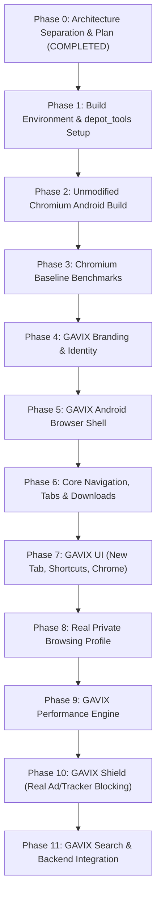

# GAVIX Browser — Architecture Blueprint & Production Plan (Phase 0)

**Entity:** ZORVAK Studios LLP  
**Product:** GAVIX Browser (`gavix.in`)  
**Architecture Status:** Production Blueprint Reset (Phase 0)  
**Date:** October 13, 2026  

---

## 1. Architecture Separation (Boundary Model)

The GAVIX repository maintains two distinct, non-conflicting directories:

```
/
├── prototype/                      # PRESERVED: Desktop PySide6/QtWebEngine prototype & UX reference
│   ├── assets/                     # Approved branding, icons, background artwork, home.html
│   ├── src/gavix_browser/          # Desktop chrome, tabs, SVG icons, local SQLite, dialogs
│   ├── tests/                      # 23 automated tests (100% passing)
│   ├── mock_server.py              # Local search API test server
│   ├── requirements.txt
│   ├── run_gavix.bat
│   └── run_mock_search.bat
│
├── chromium/                       # PRODUCTION: Native Chromium Android & Desktop codebase
│   ├── src/                        # Native Chromium source tree (managed via gclient/depot_tools)
│   │   ├── chrome/android/         # GAVIX Android application shell & activities
│   │   ├── components/gavix/       # GAVIX native C++ components:
│   │   │   ├── shield/             # Real network request filtering & ad/tracker interceptor
│   │   │   ├── performance/        # MemoryManager, TabLifecycleManager, DeviceProfileManager
│   │   │   ├── search/             # Provider-independent Search API client
│   │   │   ├── backgrounds/        # BackgroundImageProvider & caching
│   │   │   └── localization/       # Hindi, Kannada, English translation bundles
│   │   └── out/                    # Build output directories (Default, Release)
│   └── build/                      # Build flags, args.gn configurations
│
├── backend/                        # PRODUCTION: India-hosted backend services
│   ├── src/                        # TypeScript API (Search gateway, background CDN, weather proxy)
│   ├── prisma/ or db/              # PostgreSQL schemas (zero cloud browsing history)
│   └── Dockerfile                  # India-DC deployment container
│
├── benchmarks/                     # Performance baseline measurements
│   ├── chromium-baseline/          # Unmodified Chromium memory, startup, CPU
│   └── gavix-performance/          # GAVIX benchmarks across tab counts
│
└── docs/                           # Central architectural and operational documentation
    ├── ARCHITECTURE.md
    ├── GAVIX_BUILD_ENVIRONMENT.md
    ├── SECURITY.md
    ├── PRIVACY.md
    ├── THREAT_MODEL.md
    └── RELEASE.md
```

---

## 2. Chromium Foundation & Engine Strategy

| Parameter | Specification | Rationale |
| :--- | :--- | :--- |
| **Engine Core** | Native Chromium source checkout | True Chromium browser with sandbox, multi-process architecture, and Blink/V8. |
| **Target Channel / Branch** | Chromium Stable Branch (Milestone 128 / 130 LTS) | Provides stable APIs, up-to-date security patches, and battle-tested Android performance. |
| **Build Tools** | `depot_tools`, `GN`, `Ninja` / `Siso` | Standard, supported Chromium build pipeline. |
| **Primary Platform** | Android (`ARM64-v8a`, fallback `armeabi-v7a`) | Primary distribution target for Indian smartphone ecosystem. |
| **Secondary Platform** | Windows (`x86_64`) | Desktop browser sharing GAVIX C++ core components and UI. |

---

## 3. Component Architecture

### 3.1. GAVIX Performance Engine (`components/gavix/performance/`)
- **MemoryManager:** Monitors OS memory pressure callbacks (`onTrimMemory` on Android) and reclaims inactive tab renderers.
- **TabLifecycleManager:** Implements clean 5-state lifecycle: `ACTIVE` → `RECENT` → `IDLE` → `FROZEN` → `DISCARDED`. Tabs with active media or downloads are exempted from discard.
- **DeviceProfileManager:** Dynamic hardware tuning profiles:
  - `ULTRA_LIGHT` (<2 GB RAM): Aggressive tab discard, single active background, minimal preload.
  - `LIGHT` (2–4 GB RAM): Standard discard, reduced cache footprint.
  - `BALANCED` (4–8 GB RAM): Balanced background tab holding.
  - `FULL` (8 GB+ RAM): High performance caching.

### 3.2. GAVIX Shield (`components/gavix/shield/`)
- **Real Network Filtering:** Intercepts resource loads before dispatch via Chromium network service hooks (`URLLoaderThrottle` / WebRequest / ContentSubresourceFilter).
- **Rule Engine:** Pre-compiled compact filter lists (EasyList / Peter Lowe ad/tracker rules).
- **Defensible Telemetry:** Counters only increment on actual blocked requests. Zero fake counters.

### 3.3. GAVIX Search (`components/gavix/search/`)
- Provider-independent C++ abstraction (`SearchProvider`) with pluggable backend resolvers.
- Communicates with GAVIX Backend Gateway hosted in India.

### 3.4. Background Photography (`components/gavix/backgrounds/`)
- WebP/AVIF optimized delivery of curated Indian landscapes.
- Offline fallback to bundled high-resolution hero artwork.

---

## 4. Phase-by-Phase Execution Roadmap



---

## 5. Strict Constraints & Compliance
1. **No Fake Browser / No WebView Wrapper:** GAVIX Android will be a genuine Chromium build, not a WebView wrapper.
2. **Preserve Current Work:** The PySide6 prototype remains fully operational and untouched as the visual design standard.
3. **No Fake Statistics:** Every statistic shown in GAVIX Shield or Performance Engine must reflect measured reality.
4. **Zero Cloud Browsing History:** User history, tabs, and bookmarks stay local on the device.
